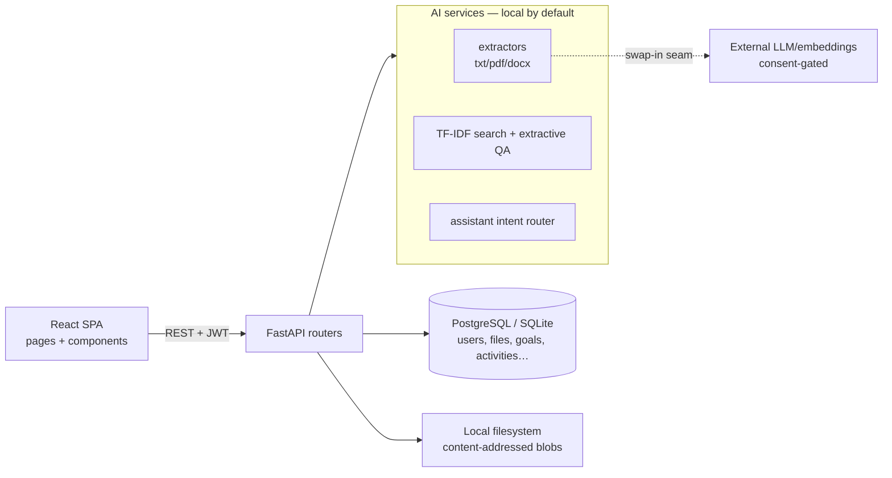

# FileMind — AI-Powered Personal Knowledge & Productivity System

FileMind unifies **file management**, **goal tracking**, **activity logging**, and
**local-first AI assistance** in one full-stack app. Upload documents, connect them to
goals, track courses / coding / projects / reading, and ask questions grounded in
your own files — with semantic search, source-cited answers, and productivity
insights that run **entirely on your machine** unless you explicitly opt into an
external provider.

**Stack:** React 18 + TypeScript + Vite + Tailwind · FastAPI + SQLAlchemy + Alembic ·
PostgreSQL (SQLite fallback) · scikit-learn TF-IDF + pypdf/docx extraction · Recharts

## Demo

## Features

| Area | What works |
|---|---|
| **My Files** | Upload/download, folders, tags, categories (8 system + custom), favorites, metadata search, image/PDF/text previews, trash + restore, SHA-256 duplicates, filename-heuristic version groups with line diff |
| **Knowledge Graph** | Interactive SVG of files, folders, goals, tasks, tags, categories (pan/zoom/drag, focus + depth, click-through navigation) |
| **Smart Search** | Meaning-based TF-IDF search with snippets/scores + document Q&A that quotes passages with file/page citations |
| **Goals** | 6 types (course, assignment, coding, project, reading, custom), tasks, milestones, per-type progress derivation, pace-based health, notes, links, reminders |
| **Activity** | Manual logging (lectures, problems, reading…) + auto-logging (completions, uploads, commits); filtered feed |
| **Dashboard** | Live metrics: active/completed/overdue/today, category progress, weekly chart, course/coding/project spotlights, 90-day heatmap |
| **Calendar** | Month grid unifying tasks, goals, milestones, reminders, past activity; agenda view |
| **AI Assistant** | Deterministic answers from your records with FACTS vs SUGGESTIONS separated; nothing is ever invented |
| **Integrations** | GitHub (import repos as project goals, log commits), honest unavailable-states for LeetCode/course sites |
| **Settings** | AI consent toggle (double-gated external processing), provider status, integrations |

## Quickstart (local development)

Prerequisites: Python 3.12+, Node 20+.

```powershell
# Backend
cd backend
python -m venv .venv; .\.venv\Scripts\Activate.ps1
pip install -r requirements.txt
copy .env.example .env
alembic upgrade head
uvicorn app.main:app --reload --port 8000   # http://localhost:8000/docs

# Frontend (new terminal)
cd frontend
npm install
npm run dev                              # http://localhost:5173
```

PostgreSQL is optional for development (SQLite fallback works out of the box):
`docker compose up -d postgres`, then set `DATABASE_URL` in `backend/.env`.

## Quickstart (Docker)

```powershell
docker compose up --build
# App: http://localhost:8080   (API proxied at /api)
```

Migrations run automatically at API startup. Override the dev-only secrets:
`SECRET_KEY=... JWT_SECRET_KEY=... docker compose up --build`.
> Dockerfiles and compose were authored in this repo but the container build has
> not been executed in CI here — please run `docker compose up --build` once on
> a Docker host to confirm before publishing.

## Configuration

All settings come from environment (see `backend/.env.example`):

| Variable | Default | Purpose |
|---|---|---|
| `DATABASE_URL` | `sqlite:///./filemind_dev.db` | Postgres (`postgresql+psycopg2://…`) or SQLite |
| `SECRET_KEY` / `JWT_SECRET_KEY` | `change-me-…` | Signing; **must be set in production** |
| `JWT_EXPIRE_MINUTES` | `1440` | Session token lifetime |
| `STORAGE_DIR` | `./storage` | File binaries (metadata stays in the DB) |
| `MAX_UPLOAD_MB` | `50` | Upload cap, enforced while streaming |
| `CORS_ORIGINS` | `http://localhost:5173` | Comma-separated allowed origins |
| `AI_PROCESSING_ENABLED` | `false` | Global kill switch for external AI |
| `LLM_BASE_URL` / `LLM_API_KEY` | _(empty)_ | OpenAI-compatible provider (empty = fully local) |
| `LLM_MODEL` / `EMBEDDING_MODEL` | `gpt-4o-mini` / `tfidf-local` | External model names |

External AI additionally requires the **per-user consent toggle** in Settings —
documents never leave the server otherwise.

## Architecture



- **Backend:** `app/api` (routes) → `app/services` (storage, library, progress, `ai/`, `integrations`) → `app/models` + `app/schemas`. Alembic migrations only — no `create_all` in app code.
- **Key invariants:** per-user scoping on every query (foreign ids → 404); client filenames never touch disk; downloads are `attachment`, previews are inert types + `nosniff`; destructive deletes require `?permanent=true`; history rows survive goal deletion; AI answers separate facts from suggestions.

## API overview

| Prefix | Endpoints |
|---|---|
| `/api/auth` | register, login, me |
| `/api/folders`, `/api/files` | CRUD, upload/download/preview, search, duplicates, versions, compare, trash |
| `/api/categories`, `/api/tags` | system + custom taxonomy |
| `/api/goals`, `/api/tasks`, `/api/milestones` | goals with derived progress + health |
| `/api/goals/{id}/files`, `/api/files/{id}/goals` | goal ↔ file links |
| `/api/activities` | manual + auto activity log |
| `/api/dashboard/summary` | all dashboard metrics from live rows |
| `/api/search/semantic`, `/api/ask`, `/api/assistant` | local-first AI |
| `/api/graph`, `/api/calendar`, `/api/reminders` | advanced views |
| `/api/integrations/*` | provider status, GitHub import/log |
| `/api/ai/status`, `/api/settings` | engine status, AI consent |
| `/api/health`, `/api/ready` | liveness + DB readiness |

## Testing

```powershell
cd backend
python -m pytest        # 53 tests: auth, files, goals, links, AI, advanced, security
cd ../frontend
npm run build           # tsc + vite production build
```

Live end-to-end smoke scripts (register → upload → goals → AI → graph) were run
against a real `uvicorn` server per phase; see commit history. Security behaviors
are pinned by `tests/test_phase7_security.py` (upload caps, traversal, preview
MIME safety, auth isolation, kill-switch precedence).

## Security model (and honest limits)

- bcrypt passwords, short-lived JWTs, per-user authorization everywhere.
- Uploads: allowlist extensions, blocked executables, streamed size cap, UUID storage names, no path traversal, never executed.
- Previews branch on server-normalized extension and serve inert content types.
- AI: local extraction/search/summaries need no consent (nothing leaves the host);
  external providers need the global switch **and** per-user consent; retrieved text
  is wrapped as untrusted data in prompts.
- Known limits: no refresh tokens / password reset; reminder delivery (email/push)
  not implemented; no OCR for scanned images; TF-IDF refits per query (fine at
  personal scale); frontend bundle ~680 KB (recharts — code-split later).

## Project structure

```
backend/  app/{api,core,db,models,schemas,services/{ai,integrations}}  tests/  alembic/
frontend/ src/{components,lib,pages}  Dockerfile  nginx.conf
docker-compose.yml   # postgres + api + web
```

Built incrementally in 7 phases (foundation → files → goals/activity → links →
local AI → advanced → hardening); each phase was implemented, tested against a live
server, and committed separately — see the git history.
